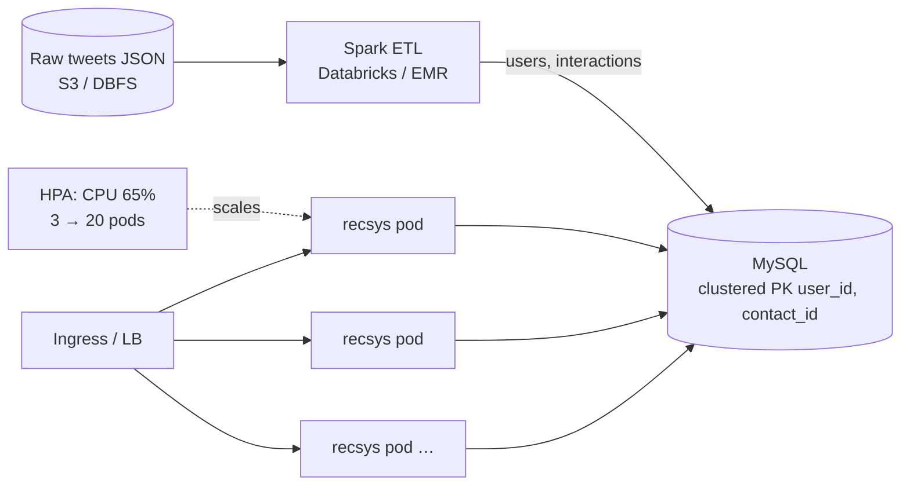

# 🐦 Twitter User Recommendation System

A **Java microservice** that recommends whom a Twitter user should interact with, ranked by interaction strength, shared niche interests and keyword relevance. It is backed by a **Spark ETL** over raw tweet JSON, served from **MySQL**, and deployed with **Docker, Helm and Kubernetes** (autoscaling, probes, disruption budgets).

```
GET /recommend?user_id=42&type=both&phrase=data&limit=3
{"userId":42,"type":"both","recommendations":[{"userId":6578,"screenName":"user6578","score":8.289,
  "interactionScore":1.099,"hashtagScore":3.773,"keywordScore":2.0,"latestTweet":"data trip recipe … #fintech #investing"}, …],"cached":false}
```

## 🏗️ Architecture



| Component | Details |
|---|---|
| **ETL** (`etl/build_tables.py`) | PySpark: parses tweet JSON (replies, retweets, mentions, hashtags), makes edges symmetric, aggregates per (user, contact) pair, keeps the latest tweet and builds per-user hashtag histograms. Writes CSV for `LOAD DATA` or writes directly over JDBC |
| **Service** (`service/`) | Java 21, JDK `HttpServer` on **virtual threads**, HikariCP pool, server-side prepared statements, batched profile lookup (one `IN (…)` query per request instead of N+1), LRU cache, `/healthz`, `/readyz` (DB check) and Prometheus `/metrics` |
| **Ranking** | `score = ln(1 + 2·replies + retweets + 0.5·mentions) × (1 + ln(1 + shared niche hashtags)) × (1 + phrase matches)`. Very common hashtags (#news, #love …) are excluded from similarity. The score breakdown is returned for explainability |
| **Deploy** | Multi-stage Dockerfile (non-root, ZGC), docker-compose for local runs, Helm chart (Deployment with rolling updates, Service, HPA, PodDisruptionBudget, secrets via `secretKeyRef`) |
| **CI** | Maven tests, `helm lint` + `helm template`, Docker build |

## ⚡ Performance (measured)

Synthetic dataset: 400k tweets, giving 20k users and **438k interaction rows**. Everything ran on one 4-vCPU VM (service, MariaDB and load generator together), with 20-second runs using the Java load generator in `loadtest/`.

| Scenario | Concurrency | Throughput | p50 | p99 | Errors |
|---|---|---|---|---|---|
| Cache enabled (steady state) | 64 | **21,500 req/s** | 2.3 ms | 14 ms | 0 |
| Cache disabled (every request hits MySQL) | 64 | **3,600 req/s** | 14.6 ms | 38.5 ms | 0 |

**Tuning story.** The first version capped at about 1,400 req/s with a constant 44 ms latency at every concurrency level. That signature points to the network rather than the database: the JDK HTTP server leaves Nagle's algorithm on, so small responses waited on 40 ms delayed ACKs. Enabling `TCP_NODELAY` (`sun.net.httpserver.nodelay`) gave a **~15× throughput gain**. Batching contact profile lookups removed an N+1 query pattern on the database path.

## 🚀 Run it

```bash
# local stack
docker compose up -d
./db/load.sh 127.0.0.1 recsys recsys          # generate tweets -> Spark ETL -> LOAD DATA
curl "localhost:8080/recommend?user_id=42&type=reply&limit=5"

# load test
java loadtest/LoadTest.java http://localhost:8080 20 64 20000

# Kubernetes
kubectl create secret generic recsys-db --from-literal=password=...
helm install recsys deploy/helm/recsys --set image.tag=1.0.0
```

## ✅ Tests

`mvn -f service/pom.xml verify` runs 6 JUnit tests: niche hashtag weighting (popular tags ignored), the request-type filter, overlapping phrase matching, cache hits, LRU eviction, and the HTTP endpoints including 400 handling and readiness.

## 🛠️ Tech stack

Java 21 · HikariCP · MySQL · PySpark · Docker · Kubernetes · Helm · GitHub Actions
